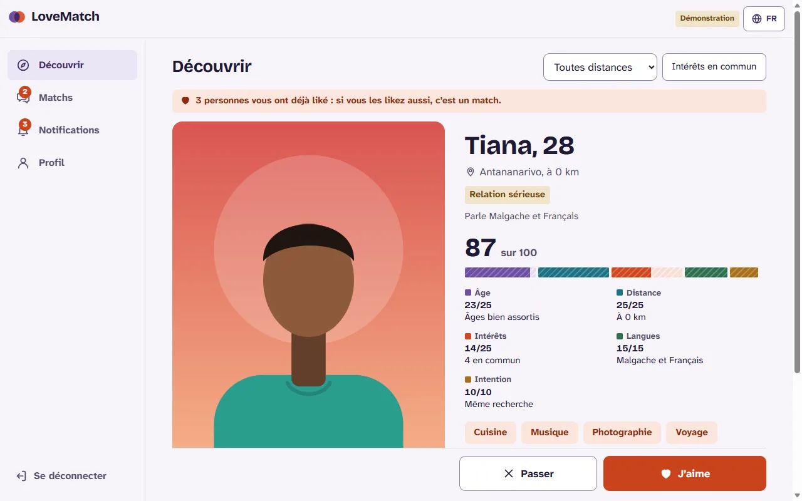
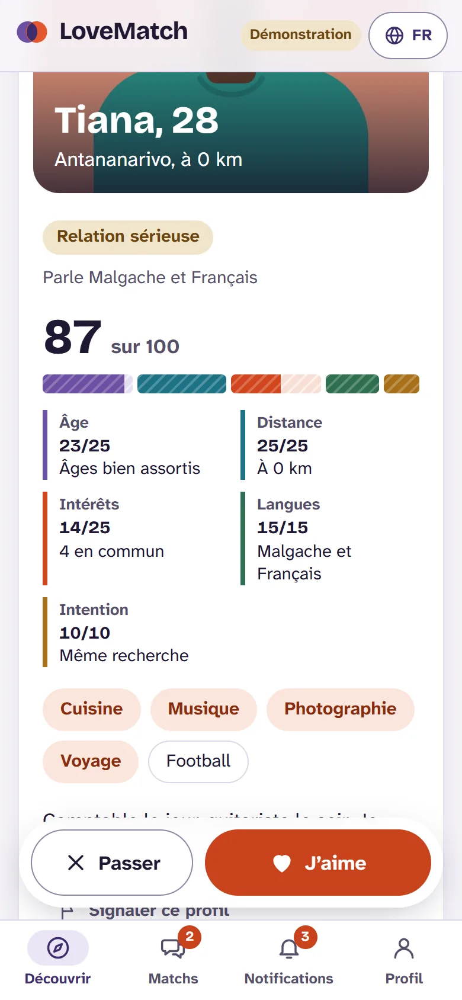
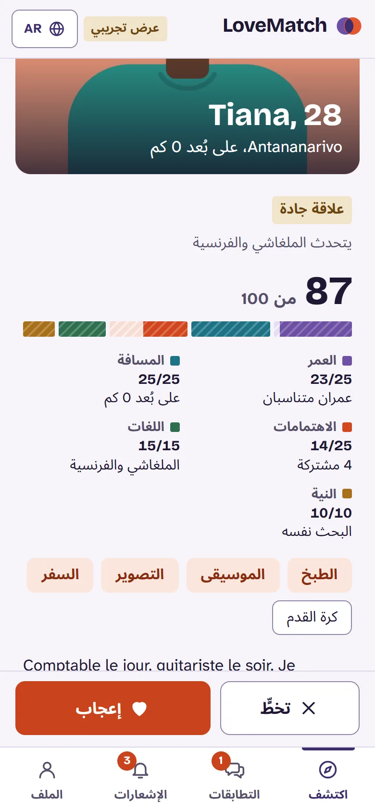
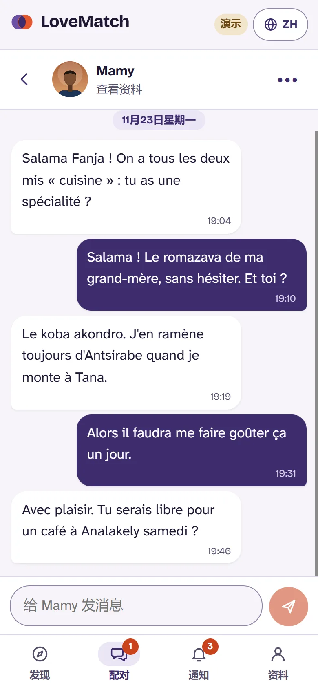

# LoveMatch

[](https://github.com/juliotjera/LoveMatch/actions/workflows/tests.yml)

Application de rencontres pour les personnes qui vivent à Madagascar, avec un **score de compatibilité expliqué** : chaque suggestion montre sa note sur 100 et la part de chacun de ses cinq critères. On ne vous propose que des personnes avec qui la discussion est possible : préférences réciproques, distance acceptée des deux côtés, **au moins une langue en commun**. Interface en **sept langues** (malagasy, français, English, español, 中文, हिन्दी, العربية), installable sur le téléphone.

Réécriture complète, en **Spring Boot 4 + Angular 22**, d'un sujet d'examen JSP de L2 que j'avais réalisé seul. Le sujet lui-même a été refait : voir le [cahier des charges, version 2](docs/CAHIER_DES_CHARGES.md).



| Score en cinq brins | Conversation en direct | En arabe, de droite à gauche | En chinois |
| --- | --- | --- | --- |
|  |  |  |  |

## Ce que fait l'application

- **Suggestions triées par compatibilité**, une à la fois : J'aime ou Passer (flèches du clavier acceptées), « Revoir » un profil passé, filtres distance et intérêts communs.
- **Match mutuel** : un like reste anonyme (« quelqu'un vous a liké ») ; si c'est réciproque, la conversation s'ouvre.
- **Messagerie en temps réel** (WebSocket STOMP) avec accusé « Vu », historique paginé, notifications en direct, idée de premier message tirée d'un intérêt commun.
- **Profil** : jusqu'à 4 photos (redimensionnées et nettoyées par le serveur), bio, 3 à 8 centres d'intérêt, 1 à 5 langues parlées, préférences (genre, tranche d'âge, rayon).
- **Sept langues** : choix à tout moment, langue du téléphone détectée, arabe de droite à gauche, erreurs de l'API traduites elles aussi.
- **Installable** (PWA) : l'interface reste sur le téléphone et s'ouvre même sans réseau ; une application Android est prévue sur la même base.
- **Sécurité des membres** : blocage (dans les deux sens), signalement avec motif, espace de **modération** (classer, avertir, suspendre, réactiver).
- **Vie privée** : nom de famille, e-mail et position jamais montrés ; suppression du compte et de toutes ses données en un clic.
- **Démonstration** : « Essayer sans compte » (membre ou modération), 27 profils fictifs de plusieurs langues, portraits dessinés, paysages réels de Madagascar ([crédits](docs/CREDITS_PHOTOS.md)), recréés chaque nuit.

## Le score, en cinq brins

| Critère | Points | Calcul |
| --- | --- | --- |
| Âge | 25 | plein score quand chacun est au centre de la tranche recherchée par l'autre |
| Distance | 25 | entre les deux villes (coordonnées, formule de haversine) : plein score sous 5 km, puis décroissance jusqu'au rayon de recherche |
| Centres d'intérêt | 25 | indice de Jaccard : intérêts communs ÷ intérêts réunis |
| Langues | 15 | une langue commune 10, deux ou plus 15 |
| Intention | 10 | même recherche (relation sérieuse, amitié, à découvrir) |

Avant tout calcul, des **filtres obligatoires et réciproques** : genre recherché, tranche d'âge et rayon de **chacun** des deux, au moins une langue commune, comptes actifs, aucun blocage. Le score est symétrique (A→B = B→A), ce qui est vérifié par un test sur toutes les paires du jeu de démonstration.

## Technique

| | |
| --- | --- |
| Serveur | Spring Boot 4.1, Java 25, Spring Security (JWT HS256 en cookie HttpOnly SameSite=Strict, CSRF), Spring Data JPA, Flyway, WebSocket STOMP, messages traduits (MessageSource + Accept-Language), OpenAPI (`/api/docs/ui`) |
| Base | PostgreSQL (production, Neon) ; H2 en mode PostgreSQL pour le développement et les tests |
| Interface | Angular 22 : composants autonomes, signaux, sans zone.js, routes protégées chargées à la demande, intercepteurs, dictionnaires JSON chargés à la demande, CSS en propriétés logiques (droite à gauche), service worker |
| Qualité | 11 tests d'acceptation sur H2 **et** PostgreSQL, vérification automatique des 7 dictionnaires, audit axe-core WCAG 2.2 AA (0 violation, y compris en arabe), CSP et Permissions-Policy |
| Déploiement | une seule image Docker (Spring Boot sert l'interface compilée), Render + Neon |

Organisation du serveur (mêmes conventions que mes projets de L3) : `config`, `controller/rest`, `dto/request`, `dto/response`, `entity`, `enumeration`, `exception`, `mapper`, `repository`, `security`, `service` + `service/impl`, `util`.

## Lancer en local

Prérequis : JDK 25 ou plus récent, Node.js 24.

```bash
# 1. le serveur (port 8090, base H2 en mémoire, démonstration activée)
cd backend
./mvnw spring-boot:run

# 2. l'interface (port 4200, les appels /api et /ws sont relayés vers le serveur)
cd frontend
npm install
npm start
```

Ouvrir http://localhost:4200 puis « Essayer sans compte ».

## Tests

```bash
cd backend
./mvnw test                                   # sur H2
DB_URL=jdbc:postgresql://localhost:5432/lovematch DB_USERNAME=… DB_PASSWORD=… ./mvnw test   # sur PostgreSQL
cd ../frontend
npm run traductions                           # les 7 dictionnaires ont les mêmes textes et variables
```

Les critères d'acceptation du cahier des charges sont des tests automatisés : aucun profil exclu par les préférences ou la langue (dans les deux sens), pas de conversation sans match ni après un blocage, aucune fuite du nom de famille ou de l'e-mail, score symétrique, erreurs traduites. Le détail est dans le [rapport de tests](docs/RAPPORT_DE_TESTS.md).

## Déploiement (Render + Neon)

1. Neon : créer un projet, copier la chaîne **JDBC** (sans le pooling).
2. Render : New > Blueprint > ce dépôt (le fichier `render.yaml` décrit le service), puis renseigner `DB_URL`, `DB_USERNAME`, `DB_PASSWORD`. Le secret des sessions est généré par Render.
3. Si Render attribue une autre adresse que `lovematch.onrender.com`, corriger `ORIGINES` (WebSocket).

Variables reconnues : `DB_URL`, `DB_USERNAME`, `DB_PASSWORD`, `JETON_SECRET`, `JETON_DUREE_HEURES`, `COOKIE_SECURISE`, `ORIGINES`, `DEMO`, `PORT`.

## Auteur

Juliot JERA, étudiant à l'ESMIA (Antananarivo). Les profils de démonstration sont fictifs ; les paysages sont crédités dans [docs/CREDITS_PHOTOS.md](docs/CREDITS_PHOTOS.md).
